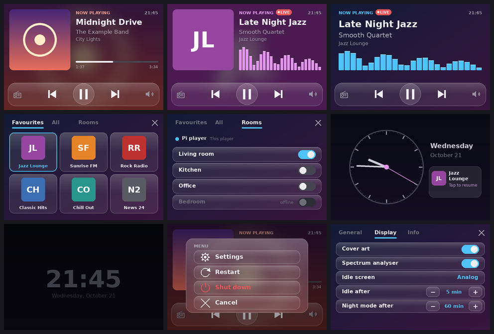
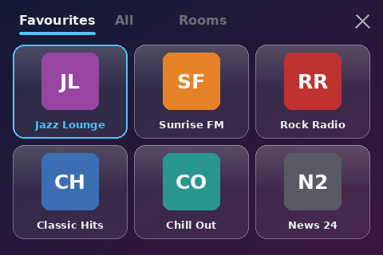
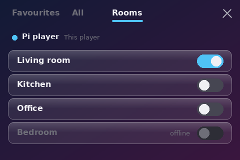
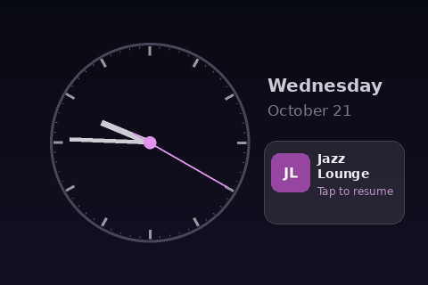
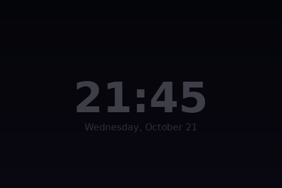
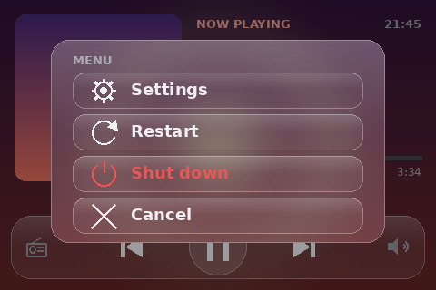
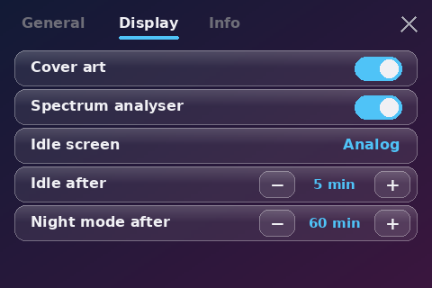

# Music Assistant Display

> Unofficial project, not affiliated with Music Assistant or the Open Home Foundation.

A now-playing touch screen for a Raspberry Pi that runs as a [Music Assistant](https://music-assistant.io)
player through `sendspin-cli`. Developed on a Raspberry Pi 2 and also tested on a Raspberry Pi 3, with a
goodtft 3.5" 480x320 SPI display (ILI9486) and an XPT2046 touch panel.

Shows title, artist, album, cover art, progress and a live spectrum, lets you control playback and
volume, pick radio stations, and resumes the last station after a restart. The UI is available in
English, Dutch, French, German, Spanish, Italian, Portuguese, Polish, Swedish and Czech.



*The pictures are drawn by the program's own renderer from made-up data (see `tools/screenshots.py`), not photos
of the panel.*

## How it works

`ma_display.py` draws with Pillow straight onto `/dev/fb0` (RGB565) and reads the touch panel via evdev.

| What | Source | Token? |
|---|---|---|
| Playback state, volume, play/pause/previous/next/volume/mute | control socket of `sendspin-cli` (`/run/sendspin-cli/control.sock`) | no |
| Title, artist, album, progress, cover, spectrum | own Sendspin client (roles metadata/artwork/controller/visualizer, port 8929) | no |
| Picking stations, resuming the last one | Music Assistant websocket API | MA token |

- Music Assistant sees the Sendspin client as a DISPLAY player. It offers unpaired (guest) access;
  without it MA does not approve it automatically and the roles stay inactive.
- If the player is playing but the display shows something else, the display sends `switch` until it
  is in the player's group. MA restores that group after a reconnect.
- MA only connects ~2 minutes after the service restarts; the buttons work immediately.
- The last played station (name, URI and logo) is kept in `/var/lib/ma-display`. After a restart it is
  shown right away, before the Sendspin metadata arrives, and **play** resumes it when the queue is empty.
- Loading the station list and starting a station are retried three times; if the list cannot be
  loaded, tap the screen to try again.

## Supported hardware

| Board | Status |
|---|---|
| Raspberry Pi 2 Model B | Developed and tested on this one. All timings in this README were measured on it. |
| Raspberry Pi 3 | Tested by the author, with the same SD card (so the same 32-bit Raspberry Pi OS install) as the Pi 2. |
| Raspberry Pi 4 | Not tested. The SPI controller driver (`spi_bcm2835`) and the display overlay are the same as on the boards above, so it should work, but that is an expectation and not a result. |
| Raspberry Pi 5 | Not tested. Its SPI controller is part of the RP1 chip and I did not check which driver that uses, so the optional `boot/modules-load-ma-display.conf` (which names `spi_bcm2835`) does not apply there. The rest is unverified. |

The program itself needs only a Linux framebuffer, an evdev touch device and `sendspin-cli`. What is specific to a
board is the display driver and overlay (see below) and the optional early-boot file. If you try another board,
please open an issue with what worked and what did not.

## Parts

What it was built with. None of this is a recommendation of a brand; it is what was used.

**Required**

| Part | Notes |
|---|---|
| Raspberry Pi 2 Model B or Raspberry Pi 3 | Both tested, see above. |
| 3.5" SPI display, 480x320, ILI9486 controller, XPT2046 touch | A goodtft module that works with `dtoverlay=piscreen` (the "piscreen" pinout), connected to the GPIO header. The layout is drawn for 480x320; other panels need another overlay and probably another resolution. |
| microSD card | 8 GB or more is plenty: the system used about 2.7 GB. A quality card is worth it, see [Making the SD card last](#making-the-sd-card-last). |
| Power supply, 5 V | Use one that is rated for the Pi (2 A or more) and check `vcgencmd get_throttled` says `0x0`. |
| A network connection | Ethernet, or Wi-Fi. A Pi 2 has no Wi-Fi: a USB dongle was used (a Realtek RTL8188EUS one). A Pi 3 has it built in. |
| Speakers or an amplifier | Connected to the Pi's 3.5 mm jack, which is the default output. |

**Software**

- Raspberry Pi OS (Debian 13 "trixie"), see `requirements.txt` for the Python packages.
- [`sendspin-cli`](https://github.com/Sendspin) running as a service: it is the audio player this display controls.
- A Music Assistant server. Tested with 2.10.6; `aiosendspin` has to match the server version (see `requirements.txt`).

**Optional**

| Part | Notes |
|---|---|
| USB to S/PDIF adapter with an optical (TOSLINK) and/or coax output, plus a TOSLINK cable | For digital audio to an amplifier or powered speakers instead of the analog jack. Not yet tested with this project; a bare TOSLINK transmitter module does not work on its own, because the Pi cannot make an S/PDIF signal itself. |
| A button on GPIO3 (`dtoverlay=gpio-shutdown`) | To start the Pi again after a shutdown from the menu; otherwise unplug and replug the power. |

## The display and touch drivers

No driver has to be installed: the kernel of Raspberry Pi OS already contains both. Developed and tested on
Raspberry Pi OS (Debian 13 "trixie"), kernel 6.18 (`rpt-rpi-v7`) on a Pi 2.

- The `piscreen` device-tree overlay, with its `drm` parameter, loads the DRM driver `ili9486`
  (through `drm_mipi_dbi`) for the panel and `ads7846` for the XPT2046 touch controller. Without `drm`
  you get the older fbtft driver instead.
- DRM provides the framebuffer `/dev/fb0` (name `ili9486drmfb`) that `ma_display.py` draws on. It needs
  the stock KMS line `dtoverlay=vc4-kms-v3d` that Raspberry Pi OS already has in `config.txt`.
- The touch panel shows up as the input device `ADS7846 Touchscreen` (config key `touch_name`).
- `rotate=` in the overlay line turns the panel. The program expects landscape 480x320, so keep
  `rotate=0`. `180` should work with a new calibration (`--calibrate`) but is untested; portrait is not supported.
- Other SPI panels need a different overlay and probably a different resolution (the layout is sized
  for 480x320).

After the reboot, check that everything is in place:

```
lsmod | grep -E "ili9486|ads7846"          # both drivers loaded
grep -l ili9486drmfb /sys/class/graphics/fb*/name   # the panel's framebuffer (fb0 or fb1)
cat /sys/class/graphics/fb1/virtual_size            # 480,320 (use the number found above)
grep -l ADS7846 /sys/class/input/event*/device/name
```

The program finds the panel's framebuffer by its driver name (`fb` = `auto`, `fb_name` = `ili9486drmfb`), because
the number depends on the order the drivers load in. Pin it with e.g. `"fb": "/dev/fb1"`.

### Rotation

The rotation is **not** a setting of `ma_display.py`. The panel driver applies it (`rotate=` on the
`piscreen` overlay line in `/boot/firmware/config.txt`, active after a reboot) and the program draws a
fixed landscape 480x320 picture. Only `rotate=0` has been tested.

To rotate by 180°, set `rotate=180`, reboot and run `--calibrate` again. This is untested. Portrait
(90°/270°) would need a different layout and is not supported.

What can and cannot be detected at runtime (investigated on a Pi 2, kernel 6.18, DRM `ili9486`):

| Source | Result |
|---|---|
| `/sys/class/graphics/fb0/virtual_size` | `480,320`: tells landscape from portrait, not 0° from 180° |
| `/sys/class/graphics/fb0/rotate` | `0`: console rotation only, unrelated to the panel |
| `rotate=` in `/boot/firmware/config.txt` | readable, tells 0/90/180/270 as of the last boot (not an edit that has not been rebooted yet) |
| Device tree (`/proc/device-tree`) | no panel or touch node with a rotation property found |
| DRM connector (`/sys/class/drm/card1-SPI-1`) | no rotation property in sysfs; `modetest` is not installed |
| Raw touch values (`ADS7846`) | plain 0-4095 on both axes; nothing shows whether the overlay also rotates the touch |

So following the rotation automatically is possible in principle (read `rotate=` from the boot config,
remember the rotation that was active during calibration, flip the touch axes if they differ by 180°),
but it is **not implemented**. It hinges on an open question: when the overlay rotates the picture, does
the kernel rotate the touch coordinates too? If it does, flipping them in the program would undo it.
That has to be measured: set `rotate=180`, reboot, and read the raw touch values while tapping two
corners.

## Installing on the Pi

Get the code: `git clone https://github.com/Rob2dev/music-assistant-display`.

1. Add `boot/config.txt.snippet` to `/boot/firmware/config.txt` and reboot (see above).
2. apt packages and venv: see `requirements.txt`.
3. Network: the Pi has to be able to reach Music Assistant on its own (see "Network" below).
4. Place the files:
   - `ma_display.py` → `/opt/ma-display/`
   - `bin/*` → `/usr/local/bin/`
   - `systemd/ma-display.service` → `/etc/systemd/system/`, then `systemctl enable --now ma-display`
5. Optional, for the power menu: `polkit/50-ma-display-power.rules` → `/etc/polkit-1/rules.d/` (see "Power menu").
6. Optional, for the station picker: set `ma_url` in `/etc/ma-display/config.json` (see
   `config.example.json`) and the token with `ssh root@<pi> -t ma-display-set-token`.

The service runs as `sendspin-cli` because its control socket is owner-only (0600).
`ma-display-tty` puts tty1 into graphics mode (as root) so the console does not draw over the picture.

## Configuration

`/etc/ma-display/config.json`; an example is in `config.example.json`. Every key is in `DEFAULTS` in
`ma_display.py`.

| Key | Meaning |
|---|---|
| `language` | `en`, `nl`, `fr`, `de`, `es`, `it`, `pt`, `pl`, `sv` or `cs`. Empty = derived from `$LANG`, otherwise English (also on the settings screen) |
| `fb`, `fb_name` | framebuffer of the panel: `auto` (default) finds it by the driver name `fb_name`, or give a path such as `/dev/fb1` |
| `ma_url`, `ma_token` | Music Assistant API for the station picker and resuming. Without both the picker is off |
| `ma_player_name` | name of the player in Music Assistant; defaults to the Pi's hostname |
| `sendspin_name` | name of this display in Music Assistant; defaults to `<hostname> display` |
| `clock_after_min` | minutes without playback before the idle screen appears |
| `idle_style` | `analog` (default) or `digital` (the plain big clock) |
| `night_after_min` | minutes without playback before the idle screen dims to a small digital time (0 = never; default 60) |
| `idle_fps` | how often the hands are redrawn (default 4) |
| `calibration` | touch calibration, written by `--calibrate` (see "Touch calibration") |

Translations live in the `STRINGS` table at the top of `ma_display.py`. To add a language, copy the
`en` block, translate it, add it to `STRINGS` and to `LANG_NAMES` (its own name, shown in the language list),
then run `tools/screenshots.py` or look at the screens to check that the texts fit. Missing keys fall back to
English. The font (DejaVu Sans) covers Latin, Cyrillic and Greek; Chinese, Japanese, Korean, Thai and Hindi need
another font, and right-to-left languages would need the layout mirrored.

**The translations other than English are drafts.** They were written with the help of an AI and have not been
reviewed by native speakers. Corrections are very welcome. The Portuguese is leaning Brazilian.

## Network

The Pi needs a working network connection after every boot. If it comes up without one there are no
stations, no connection to Music Assistant, and the clock runs behind (NTP cannot sync, and a Pi has no
battery-backed clock). So **if you use wifi, it must be configured as a saved connection**.

Set it up once on the Pi. Create the profile explicitly: `nmcli dev wifi connect` fails with
"key-mgmt: property is missing" when the SSID is visible on several channels.

```
nmcli con add type wifi ifname wlan0 con-name <ssid> ssid <ssid> wifi-sec.key-mgmt wpa-psk wifi-sec.psk '<password>'
nmcli con up <ssid>
```

Check with `nmcli -f NAME,UUID,TYPE,DEVICE con show`: there must be exactly one profile for the SSID,
attached to `wlan0` (a duplicate profile without a password gives "Secrets were required"), and
`nmcli dev show wlan0` has to show an address. A weak signal makes the connection flaky (a Pi 2 uses a
USB wifi dongle); a cable is the reliable alternative.

## Rooms: who is in the group

<p>
</p>

Open the station picker and choose the **Rooms** tab. At the top is this player; below it every player that is in
its group or could be (displays are left out): members first, players that are offline last and greyed out. A
switch on the right shows who is in the group.

Tap a player to add it to the group or remove it. A confirmation comes first, because a wrong tap starts or stops
the music in another room. Offline players cannot be added. The list refreshes every few seconds while it is open.

This uses the Music Assistant API (`players/all`, and `players/cmd/set_members` to change the group), so it needs
`ma_url` and `ma_token` like the station picker. The Sendspin connection does not tell the display who is in the
group: its group message only carries the playback state, the group id and the group name.

## The idle screen

<p>
</p>

After `clock_after_min` minutes without playback the player screen makes way for an idle screen: an analog
clock with a sweeping second hand, the weekday and date, and a tile with the last station (**tap the tile to
resume it**; any other tap wakes the player screen).

It is built to be gentle on the panel and the Pi:
- The whole picture drifts slowly (a pixel every few seconds, within ±14 × ±8 px), so no static image sits on the
  panel, and the colour of the text shifts over the day towards the accent colour of the station logo.
- The face, date and tile are drawn once and cached; each frame only draws the hands, a 240 × 240 px strip. That
  costs about 30 ms per frame on a Pi 2 and ~23 % of one core at 4 frames per second (measured).
- After `night_after_min` minutes (default 60) it turns into a small, dim digital time that drifts further.
- `idle_style: digital` brings back the plain big clock.

The panel is an LCD, so it does not burn in like an OLED, but a static high-contrast image can leave a temporary
afterimage; the drift avoids that. Its backlight cannot be dimmed from software, so for long absences use the
power menu (or a socket timer).

## Menu and settings

<p>
</p>

**Long-press the clock** in the top-right corner of the player screen (about 1.5 s). A menu opens with
**Settings**, **Restart**, **Shut down** and **Cancel**.

**Settings** has three tabs. *General* and *Display* change with a tap on the row (or − / +):

| Tab | Setting | Values |
|---|---|---|
| General | Language | opens a list of the ten languages, each by its own name (applies at once) |
| General | Volume step | 1, 2, 5, 10 |
| General | Reset to defaults | back to the values in `config.json` |
| Display | Cover art | on / off |
| Display | Spectrum analyser | on / off |
| Display | Idle screen | analog / digital |
| Display | Idle after | 1–60 min |
| Display | Night mode after | off, or 15–240 min in steps of 15 |

With **cover art off** the player screen has no cover and no blurred background; the title, artist and album use the
freed width, in bigger type, and the progress bar and the analyser stretch to the edges. With the **analyser off**
the spectrum is not drawn and the Sendspin client drops the spectrum frames it is sent. Both are also `show_cover`
and `show_analyser` in `config.json`.

*Info* shows the hostname, IP address, uptime, whether Music Assistant is connected and the CPU temperature.
The screen closes by itself after 60 s without a tap.

These settings are saved in `/var/lib/ma-display/settings.json`, not in `config.json`: the service may write
its state directory but not `/etc/ma-display/config.json`, which can hold the token. The order is built-in
defaults, then `config.json`, then `settings.json`, so what you set on the screen wins; "Reset to defaults"
removes the file. Everything else (`ma_url`, `ma_token`, the framebuffer, touch name, …) stays in `config.json`.

The menu is also where you shut down or restart. It closes by itself after 20 s, or when you tap beside it.
After you choose Restart or Shut down, the screen says the Pi is shutting down or restarting.

The service runs as an unprivileged user, so it needs permission to do this. Install the polkit rule
(it allows `sendspin-cli` to power off and reboot, and nothing else):

```
cp polkit/50-ma-display-power.rules /etc/polkit-1/rules.d/    # as root; polkit reads it without a restart
```

Check it without powering off: both commands must print `s "yes"`.

```
runuser -u sendspin-cli -- busctl call org.freedesktop.login1 /org/freedesktop/login1 org.freedesktop.login1.Manager CanPowerOff
runuser -u sendspin-cli -- busctl call org.freedesktop.login1 /org/freedesktop/login1 org.freedesktop.login1.Manager CanReboot
```

Without the rule the menu still opens, but choosing an option shows "Power command failed". The commands
are configurable: `shutdown_command` and `restart_command` in the config (default `["systemctl",
"poweroff"]` and `["systemctl", "reboot"]`).

A Raspberry Pi does not start by itself after a shutdown: unplug and replug the power, or add a button
between GPIO3 and ground with `dtoverlay=gpio-shutdown` in `config.txt` (it also shuts the Pi down).

## Booting faster

A Pi 2 needs ~33 s to boot, and the panel is white until its driver starts. Three changes bring the first useful
picture forward (measured on a Pi 2, kernel 6.18; one boot per step, so read the numbers as ±1 s):

| Step | Panel gets its first picture | `ma-display` running |
|---|---|---|
| stock | 20.0 s | 45.1 s |
| 1. cloud-init off | 19.8 s | 41.6 s |
| 2. + drivers loaded early | 14.8 s | |
| 3. + `ma-display` starts early | 15.0 s | 22.4 s (first frame 27.4 s) |

(Seconds after the kernel started; the firmware needs a few more seconds before that.)

1. **Switch cloud-init off** once the Pi is set up (it costs seconds of CPU on every boot):
   `touch /etc/cloud/cloud-init.disabled` (undo by deleting the file).
2. **Load the display drivers early** instead of waiting for udev:
   `cp boot/modules-load-ma-display.conf /etc/modules-load.d/ma-display.conf`.
3. **Start the service early.** `systemd/ma-display.service` has no ordering on the network or on `sendspin-cli`:
   the program waits for the framebuffer, the touch device and the network by itself, and shows "Starting…" until
   the player answers.

Two things follow from loading the driver early, and the program handles both: the panel becomes `fb1` instead of
`fb0` (so it is looked up by name), and nothing enables the panel's display pipeline any more (the console stays on
the HDMI framebuffer), so the program switches it on itself with a framebuffer ioctl. If you see a black screen
while the service runs, check `/sys/kernel/debug/dri/*/state` for `crtc-0 enable=1`.

The white screen in the first seconds cannot be avoided in software: the panel shows white until the driver sends
its init sequence, and its backlight is on from power-up.

## Making the SD card last

The display itself writes almost nothing: `last_played.json` and `last_logo.png` only when the station or
track changes, and each station logo once. The state directory `/var/lib/ma-display` stays around 100 kB.
Measured on a Pi 2 (Raspberry Pi OS trixie), the card is mostly at risk from a **sudden power loss**, not
from wear.

Already the case on stock Raspberry Pi OS: the root filesystem is mounted `noatime`, swap is zram (in RAM),
`/tmp` is tmpfs, and the journal is volatile (`40-rpi-volatile-storage.conf`), so logs do not touch the card.

Worth doing on top of that (on the Pi, as root):

```
# keep the in-RAM journal small
mkdir -p /etc/systemd/journald.conf.d
cat > /etc/systemd/journald.conf.d/10-volatile.conf <<'EOF'
[Journal]
Storage=volatile
RuntimeMaxUse=16M
EOF
systemctl restart systemd-journald

# no scheduled package-list/man-db refreshes (update by hand: apt update && apt upgrade)
systemctl disable --now apt-daily.timer apt-daily-upgrade.timer man-db.timer
```

Disabling the timers also means no automatic updates, so update the Pi yourself now and then.

- Shut the Pi down with the power menu (or `shutdown`) instead of pulling the plug, and use a decent power supply
  (`vcgencmd get_throttled` should say `0x0`).
- Take an image of the card (`dd`) once it works, so a dead card is a ten-minute restore.
- A large card with plenty of free space spreads the wear; a "high endurance" card helps further.
- A read-only root with an overlay (`raspi-config`) is the strongest protection, but the state directory
  then needs a writable partition and every config change needs a remount, so it is not recommended
  unless the display runs unattended.
- To measure the write load, run this twice some hours apart and subtract (total since boot):
  `awk '{printf "%.0f MB\n", $7*512/1048576}' /sys/block/mmcblk0/stat`.

## Touch calibration

The touch controller reports raw values (0-4095) that have to be mapped to screen pixels. The defaults in
`DEFAULTS["calibration"]` belong to the panel this was developed on, so **calibrate a new panel (and after
changing the rotation)**; otherwise taps land in the wrong place.

```
systemctl stop ma-display
/opt/ma-display/venv/bin/python /opt/ma-display/ma_display.py --calibrate
systemctl start ma-display
```

- Run it as root, with the service stopped (the service holds the touch device and the framebuffer).
- Tap the three crosshairs as precisely as you can: top-left, top-right, bottom-left.
- The result is saved in `/etc/ma-display/config.json` under `calibration` and printed on screen:
  `swap_xy` (the raw axes are exchanged) and `x_min`/`x_max`/`y_min`/`y_max` (the raw values at the screen
  edges; `min` larger than `max` means that axis is inverted). The file keeps its owner and mode, so a
  token in it stays private.
- Check it by tapping the buttons. If taps are consistently off, calibrate again and aim at the centre of
  the crosshair. `ma_display.py --debug` logs the raw values of every tap.

## Handy

- Calibrate touch: `systemctl stop ma-display && /opt/ma-display/venv/bin/python /opt/ma-display/ma_display.py --calibrate && systemctl start ma-display`
- Screenshot of the screen: `fbshot /tmp/fb.png`
- Redraw the pictures in this README: `python3 tools/screenshots.py` (writes `docs/screenshots/`)
- Test picture without a display: `ma_display.py --demo --png /tmp/demo.png` (set `LANG=de_DE.UTF-8` to try a language)
- Config: `/etc/ma-display/config.json`; state: `/var/lib/ma-display`

## Tests

```
python3 -m unittest discover -s tests -t tests
```

Only the standard library is needed. The tests that draw text need the DejaVu fonts (`fonts-dejavu-core`) and the
touch test needs `python-evdev`; without them those tests are skipped, not failed. On a Pi 2 the whole set takes about
a minute. They cover the settings storage, every translation (complete, same placeholders, and whether each text
fits its place), the tap areas, what the app does on a tap (menu, settings, language list, rooms), the Music
Assistant client (group list, retries, what is remembered), long-press detection with a fake touch device, and that
every screen draws in every language. When you add a language, `tests/test_translations.py` tells you what is
missing or too long.

## Testing the visualizer

`tools/gen_sweep.py out.wav` makes a test signal: a log sweep 40 Hz-16 kHz (24 s) followed by
10 beeps of 1 kHz, one per second. Put the file somewhere Music Assistant can fetch it
(e.g. `python3 -m http.server` on the Pi) and play the URL with `player_queues/play_media`.
During the sweep the lit-up bar has to travel evenly from left to right; the bars have to jump
exactly on the beeps.

## License

[MIT](LICENSE)
